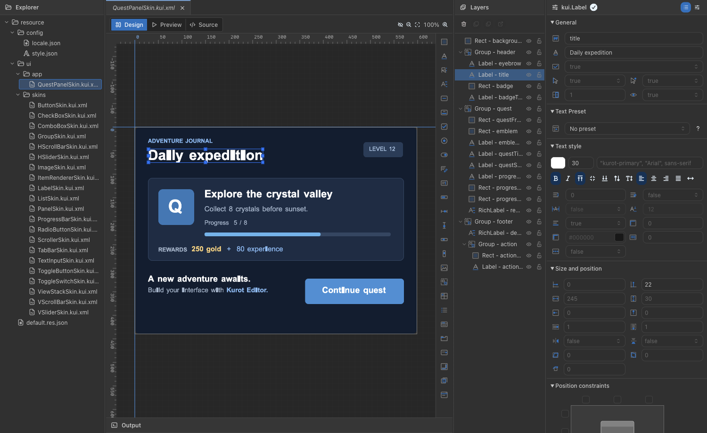
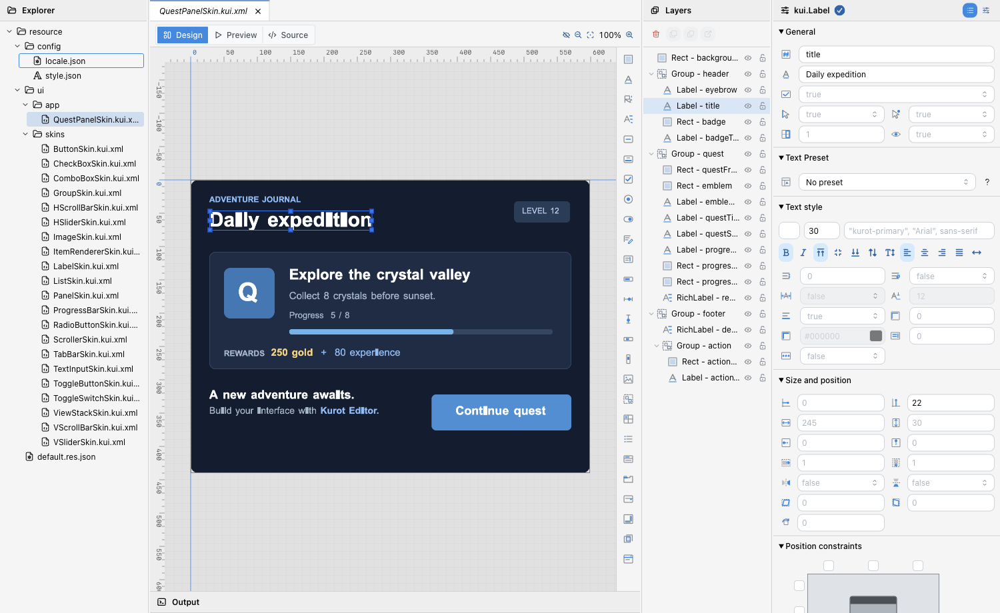
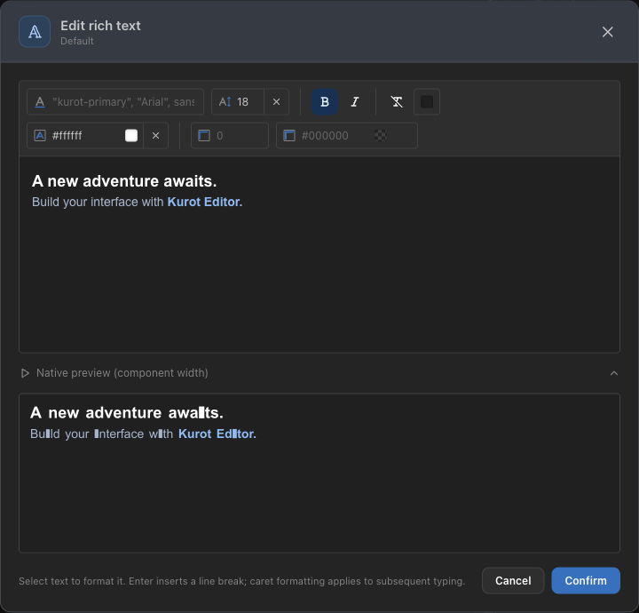
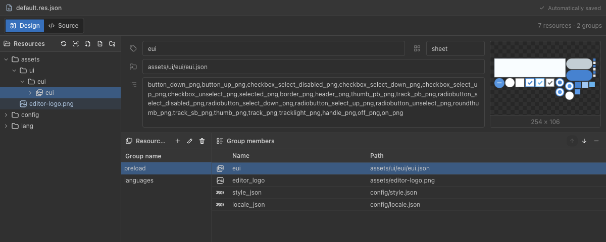
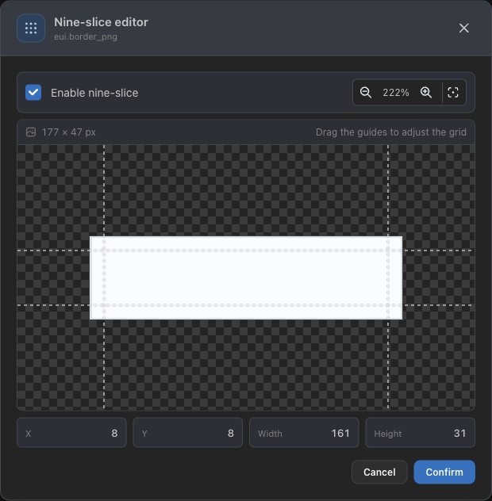
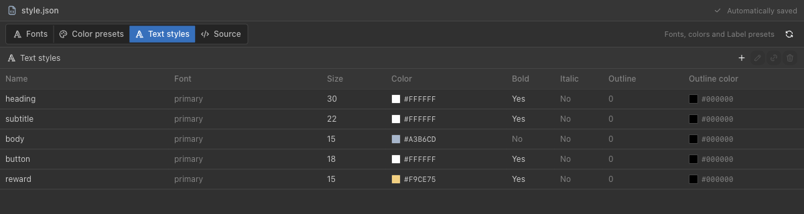
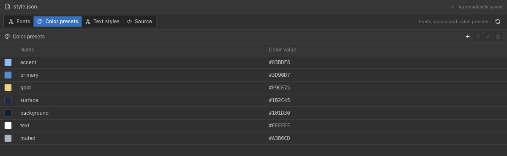
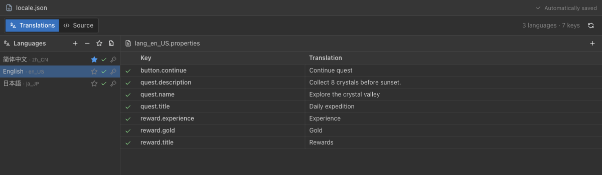
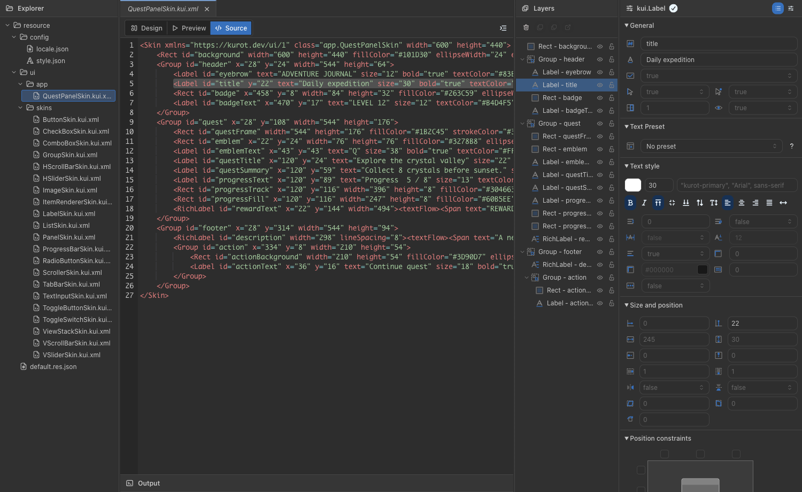

# Kurot Editor

**English** | [简体中文](README.zh-CN.md)

**A desktop UI editor for Kurot projects.**

Open your project's `.kui.xml` files, arrange components on the canvas, edit layouts, text and resources, preview with Kurot's native renderer, and save your changes back to the project.

[Downloads & releases](https://github.com/kurot-engine/kurot-editor-release/releases) · [Report an issue](https://github.com/kurot-engine/kurot-editor-release/issues)



## Download and install

Currently available for **macOS on Apple Silicon (M-series chips)**. The installed app runs without a separate Node.js or Bun installation.

1. Choose a version from [Releases](https://github.com/kurot-engine/kurot-editor-release/releases) and download `Kurot-Editor-<version>-mac-arm64.dmg`.
2. Open the DMG, drag **Kurot Editor** into **Applications**, and launch it. You can also download the ZIP, extract the app and move it into Applications.
3. Choose **File → Open project folder…** and select your Kurot project's root directory.
4. Open a skin file, make your changes, and press `Cmd+S` to save.

Release builds include **Check for Updates…** to view release notes, download an update and restart to install it after handling unsaved changes. See each release's notes for its changes.

## Features

- **Design and preview:** Select, move, resize, marquee-select, group and reorder components. Check layouts, resources and nested components with the native preview.
- **Text editing:** Adjust fonts, sizes, colors, outlines and alignment. Supports Label, BitmapLabel and RichLabel rich text.
- **Layer controls:** Hide or lock components and their children. Hidden layers appear gray in the Layers panel. These settings affect only the editor's design view and are stored with the project, leaving component `visible` properties and skin XML unchanged.
- **Resource management:** Browse images, atlases and frames; register resources, manage resource groups, refresh atlases and edit nine-slice grids.
- **Shared styles:** Inspect project font settings, manage colors and Label presets, and find style references.
- **Localization:** Manage project languages, the default language, translation keys and their values.
- **Reusable components:** Create custom components, open their skins or extract a component from a Group.
- **File workflow:** Work across tabs with undo, redo and explicit saves, plus notifications for external file changes and save conflicts.

## Screenshots

Captured in Kurot Editor 0.27.1 using a sample project. Click an image to view it at full size.

### Design workspace and light theme

Project files, the canvas, layers and properties share one workspace. The canvas provides rulers, zoom, pan and component outlines. Choose a dark, light or system theme, with an English or Chinese interface.



### Rich text editing

Type directly into the editor and select text to change its size, emphasis, color or outline. Expand the native layout preview below the editing area. Change the editing and preview background to make light or dark text easier to see.



### Images, atlases and resource groups

The resource manager opens in its own window. Browse atlases and frames, inspect resource paths and previews, and organize loading groups.



### Nine-slice editing

Drag the guides over a checkerboard background to define the stretchable region. Guides span the viewport, while zoom and pan help with precise placement. Edit resource defaults and component overrides separately.



### Text styles

Manage Label presets for headings, body text, buttons and other roles. Define fonts, sizes, colors, emphasis and outlines centrally, then reference them from components.



### Color presets

Maintain the project's palette as named presets for skins to reference. Reference lookup helps locate where a preset is used.



### Languages and translations

Switch languages, choose the default and edit translations in a separate window. Search the built-in language catalog when adding a language.



### XML source view

Design changes are saved as KUI XML in your project. The source view offers syntax highlighting, linked component selection, search and an explicit formatting command. The source view is read-only; edit the interface in Design mode.



## Open your project

Select the project root containing `kurot.config.ts`. A typical layout is:

```text
MyGame/
├── kurot.config.ts
└── resource/
    ├── default.res.json
    ├── config/
    │   ├── style.json
    │   └── locale.json
    └── ui/
        ├── app/
        ├── eui/
        └── components/
```

The skin directory is configured through `ui.sourceDir`, usually `resource/ui`. Optional `style.json` and `locale.json` files provide project fonts/styles and localization settings.

The editor reads and saves project files directly. Skins use explicit saves; closing a file, switching projects or quitting prompts you to handle unsaved changes. Compile the project with its existing Kurot CLI workflow.

## Keyboard shortcuts

| Action                    | macOS shortcut              |
| ------------------------- | --------------------------- |
| Open project              | `Cmd+Shift+O`               |
| New KUI file              | `Cmd+N`                     |
| Save / save all           | `Cmd+S` / `Cmd+Option+S`    |
| Save as                   | `Cmd+Shift+S`               |
| Design / preview / source | `Cmd+1` / `Cmd+2` / `Cmd+3` |
| Copy / cut / paste        | `Cmd+C` / `Cmd+X` / `Cmd+V` |
| Undo / redo               | `Cmd+Z` / `Cmd+Shift+Z`     |
| Settings                  | `Cmd+,`                     |

## Feedback

For bugs and feature requests, [open an issue](https://github.com/kurot-engine/kurot-editor-release/issues). Include your Editor and macOS versions, steps to reproduce and relevant screenshots. A minimal sample skin is helpful when available.

This repository hosts Kurot Editor installers, release notes and the product introduction.
