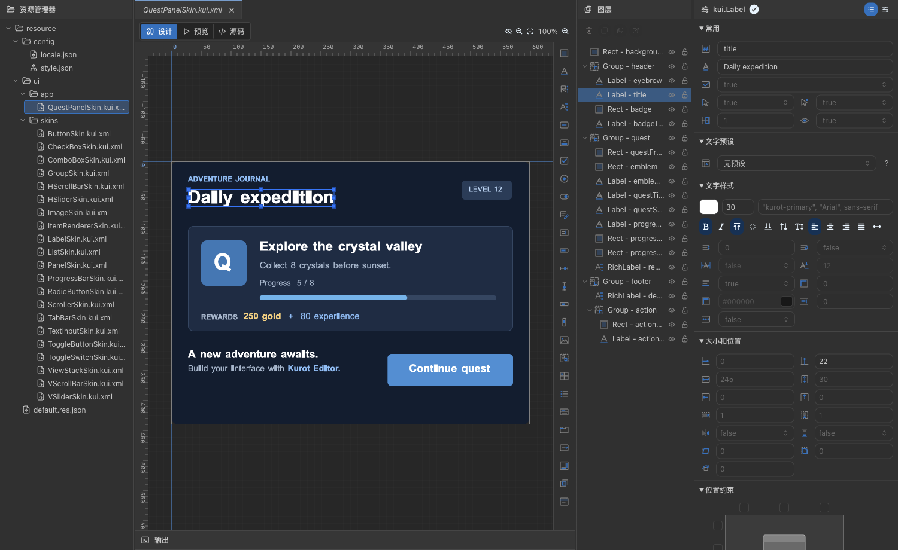
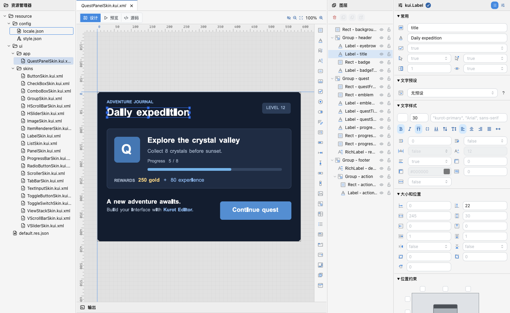
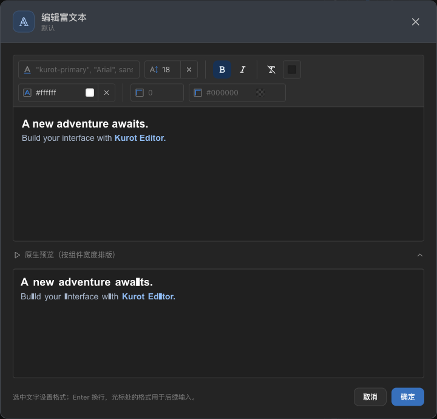
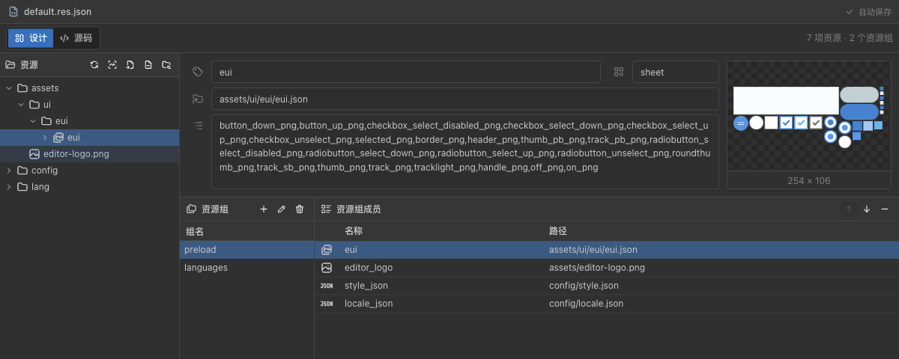
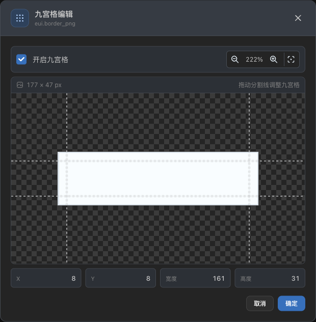
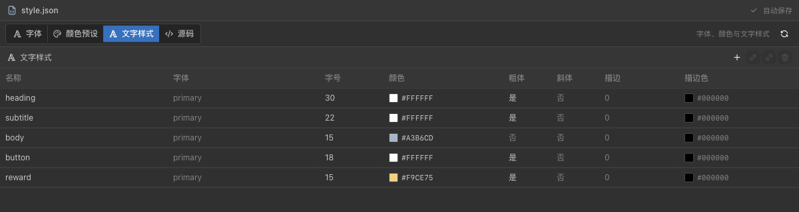
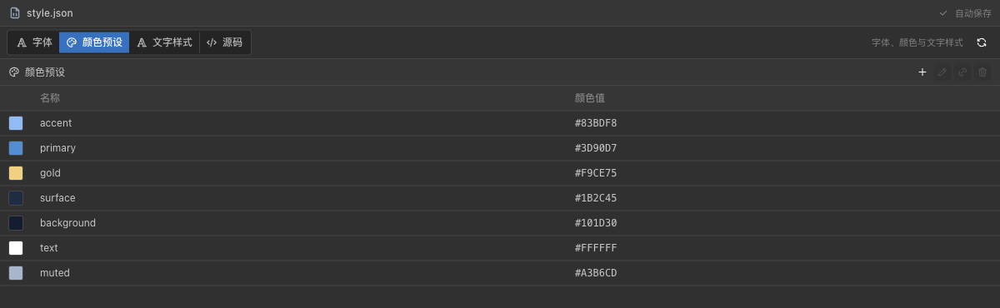
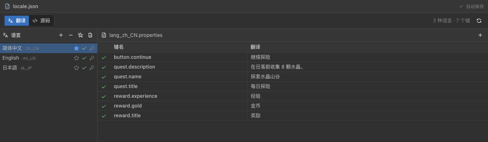
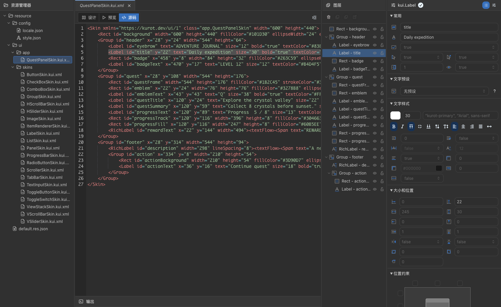

# Kurot Editor

[English](README.md) | **简体中文**

**面向 Kurot 项目的桌面 UI 编辑器。**

直接打开项目中的 `.kui.xml`，在画布上调整组件、布局、文字和资源，通过 Kurot 原生渲染预览效果，再把修改保存回项目文件。

[下载与版本记录](https://github.com/kurot-engine/kurot-editor-release/releases) · [反馈问题](https://github.com/kurot-engine/kurot-editor-release/issues)



## 下载与安装

目前提供 **macOS Apple Silicon（M 系列芯片）** 版本。安装后的应用可直接运行，无需另外安装 Node.js 或 Bun。

1. 在 [Releases](https://github.com/kurot-engine/kurot-editor-release/releases) 中选择版本，下载 `Kurot-Editor-<版本>-mac-arm64.dmg`。
2. 打开 DMG，将 **Kurot Editor** 拖入 **Applications**，然后启动应用。也可以下载 ZIP，解压后放入 Applications。
3. 使用“文件 → 打开项目文件夹…”选择 Kurot 项目根目录。
4. 打开皮肤文件，编辑后按 `Cmd+S` 保存。

正式版本提供“检查更新…”入口，可查看更新说明、手动下载，并在处理未保存内容后重启安装。每个版本的具体变更见对应 Release 说明。

## 可以做什么

- **设计与预览**：选择、移动、缩放、框选、分组和调整图层；通过原生预览检查布局、资源及嵌套组件。
- **文字编辑**：配置字体、字号、颜色、描边和对齐，支持 Label、BitmapLabel 及 RichLabel 富文本。
- **图层管理**：隐藏和锁定组件及其子元素。隐藏对象在图层面板中变灰；这些设置只影响编辑器设计视图，保存在项目中，不改变组件的 `visible` 或皮肤 XML。
- **资源管理**：查看图片、图集和子纹理，登记资源、维护资源组、刷新图集，以及编辑九宫格。
- **统一样式**：查看项目字体配置，管理颜色和 Label 文字预设，查询样式引用。
- **多语言内容**：管理项目语种、默认语言及翻译键值。
- **组件复用**：创建自定义组件、打开组件皮肤，或从 Group 提取组件。
- **文件工作流**：多标签编辑、撤销与重做、手动保存，以及外部文件变化与保存冲突提示。

## 界面一览

以下截图使用示例项目，拍摄于 Kurot Editor 0.27.1。点击图片可查看大图。

### 设计工作台与浅色主题

项目文件、画布、图层和属性面板集中在同一工作台。画布支持标尺、缩放、平移和组件边界；编辑器提供深色、浅色及跟随系统的外观，界面可切换中文或英文。



### 富文本编辑

直接输入正文，选中文字设置字号、粗体、斜体、颜色和描边。编辑区下方可展开原生排版预览，也可以随时更改编辑与预览的背景颜色，方便查看浅色或深色文字。



### 图片、图集与资源组

资源管理器在独立窗口中打开。浏览图集和子纹理，查看资源路径与预览，管理加载用的资源组。



### 九宫格编辑

在棋盘格背景上拖动分割线，调整九宫格区域。参考线贯穿视口，缩放和平移便于精确定位；资源默认值与组件局部覆盖分别编辑。



### 文字样式

集中管理标题、正文、按钮等 Label 文字预设。字体、字号、颜色、粗斜体及描边可以统一配置，再在组件上引用。



### 颜色预设

将项目配色集中维护为命名预设，供皮肤引用；引用查询帮助定位使用位置。



### 语言与翻译

在独立语言窗口中切换语种、设置默认语言并编辑翻译内容。新增语种可从内置语言目录中搜索选择。



### XML 源码视图

设计结果保存为项目的 KUI XML。源码视图提供语法高亮、组件选中联动、搜索与显式格式化，方便核对界面结构。源码视图只读；界面修改通过设计视图完成。



## 打开你的项目

选择包含 `kurot.config.ts` 的项目根目录。常见结构如下：

```text
MyGame/
├── kurot.config.ts
└── resource/
    ├── default.res.json
    ├── config/
    │   ├── style.json
    │   └── locale.json
    └── ui/
        ├── app/
        ├── eui/
        └── components/
```

皮肤目录由 `ui.sourceDir` 指定，通常为 `resource/ui`。`style.json` 和 `locale.json` 是可选配置，分别用于项目字体／样式及多语言内容。

编辑器直接读取和保存项目文件。皮肤采用手动保存；关闭文件、切换项目或退出时，会提示处理未保存内容。项目编译仍沿用项目自己的 Kurot CLI 流程。

## 常用快捷键

| 操作             | macOS 快捷键              |
| ---------------- | ------------------------- |
| 打开项目         | `Cmd+Shift+O`             |
| 新建 KUI 文件    | `Cmd+N`                   |
| 保存／保存全部   | `Cmd+S`／`Cmd+Option+S`   |
| 另存为           | `Cmd+Shift+S`             |
| 设计／预览／源码 | `Cmd+1`／`Cmd+2`／`Cmd+3` |
| 复制／剪切／粘贴 | `Cmd+C`／`Cmd+X`／`Cmd+V` |
| 撤销／重做       | `Cmd+Z`／`Cmd+Shift+Z`    |
| 设置             | `Cmd+,`                   |

## 反馈

遇到问题或有功能建议，请提交 [Issue](https://github.com/kurot-engine/kurot-editor-release/issues)。描述中附上 Editor 版本、macOS 版本、复现步骤和相关截图；能提供最小示例皮肤时，也请一并附上。

本仓库用于发布 Kurot Editor 安装包、版本说明和使用介绍。
